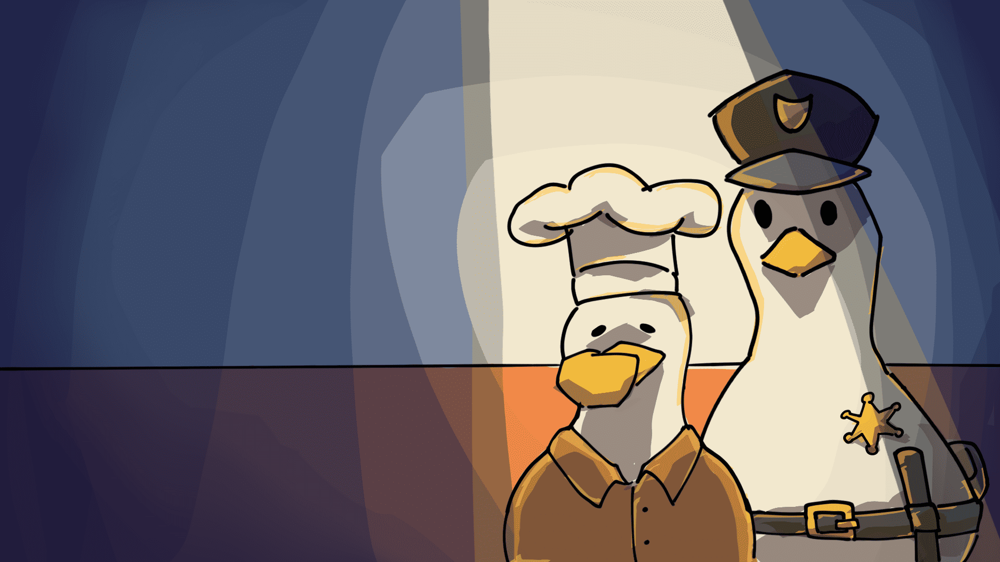

# Quack Cook

**Cook. Serve. Survive. Quack.**

### [Play Quack Cook on itch.io](https://suppaking.itch.io/quackcook)

The prisoners are hungry. The kitchen is chaos. And somehow, you're the duck in charge.

Quack Cook is a single-player, first-person cooking and action game where you run a prison kitchen one increasingly chaotic day at a time. Cook meals, keep the serving stations stocked, and serve each prisoner what they ordered before their patience runs out.

The prisoners have a meal quota. You have a frying pan. They have very little patience. You can probably see where this is going.

## How to play

1. **Prepare the kitchen.** You have 30 seconds before the kitchen opens automatically. Use the lever to open early if you're ready.
2. **Cook and restock.** Prepare food and fill the matching serving stations. Keep an eye on the stove—food can burn.
3. **Serve the right orders.** Watch each prisoner's food icon and serve them at the correct station.
4. **Handle the chaos.** Wrong orders and long waits make prisoners angry. Use throwable objects to defend yourself.
5. **Meet the daily target.** Once the queue and angry prisoners are cleared, close the kitchen with the lever or wait for the closing countdown.
6. **Survive another day.** More prisoners, bigger orders, and less patience await. Miss the daily target and it's game over.

## Features

- First-person cooking, serving, and physics-based throwing.
- Endless days with increasing difficulty and daily serving targets.
- Prisoner queues, randomized food orders, and patience management.
- Burning food, kitchen fires, and combat with angry prisoners.
- Manga-style opening and game-over cutscenes.
- An illustrated tutorial and adjustable mouse sensitivity, sound effects, and music volume.

## Controls

| Input | Action |
| --- | --- |
| WASD | Move |
| Mouse | Look around |
| Left click | Pick up or interact |
| Hold and release left click while carrying an item | Charge and throw |
| Q | Drop an item |
| Space | Jump |
| Shift | Dash |
| Tab | Pause |

## Continuing a game

Use **Save & Return to Main Menu** from the pause menu to keep your current day checkpoint during the same game session. **Continue** starts that day again with a fresh kitchen; item positions are not restored.

**The checkpoint only lasts while the application is open. Closing and reopening the game resets your progress to day one.**

## Running the project

Built with **Godot 4.7**, using the **Compatibility** renderer and **Jolt Physics**.

1. Import `project.godot` into Godot.
2. Allow Godot to finish importing the assets.
3. Press **F5** to launch the game from the main menu.

To test the kitchen directly, open `scenes/main.tscn` and press **F6**.

### Project guide

| Folder | Contents |
| --- | --- |
| `scenes/` | Gameplay, characters, interactable objects, and UI scenes |
| `scripts/` | Gameplay logic, managers, and UI behavior |
| `assets/` | Models, textures, icons, fonts, and audio |
| `shaders/` | Visual effects and scene transitions |
| `docs/` | Project documentation and testing notes |

The project uses five autoloads: `GameManager`, `QueueManager`, `SceneTransition`, `AppSettings`, and `AudioManager`.

- [Project structure](docs/project_structure.md)
- [Audio guide](docs/audio_guide.md)
- [Settings, audio, and reports](docs/settings_audio_reports.md)
- [Testing documentation](docs/testing/)

## Credits

### Development team

| Developer | Student ID |
| --- | --- |
| Naphat Thongon | 683380073-8 |
| Bannarot Porndonko | 683380301-1 |
| Ratchanon Ruengcharat | 683380094-0 |
| Natthawat Tanphibool | 683380075-4 |

### Assets and tools

- **Kitchen model:** KayKit — Restaurant Bits
- **Transitions:** godot-modular-transitions
- **Shader:** godot-ultimate-toon-shader
- **Font:** Titan One — Google Fonts
- **Engine:** Godot 4.7

---

Put on your chef hat, flap into the kitchen, and get cooking. **Quack!**
